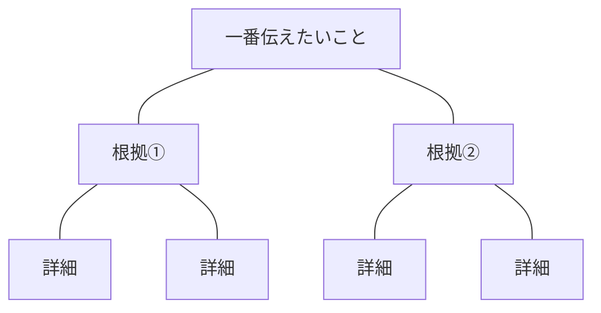
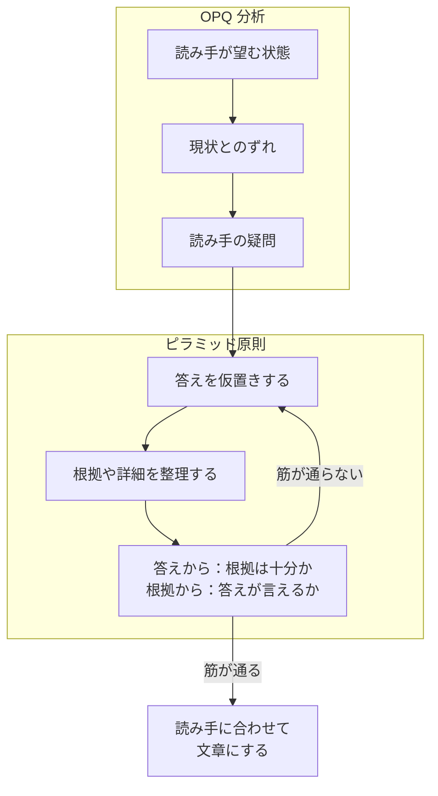

今の時代、技術的な勉強よりも考え方や伝え方の学習に力を入れた方がよいのではないかと思った。

ということで考えを整理して伝える方法について本を読んでみた。

学んだことを実践しやすくするために、何から考え、どう確かめるかを自分なりに整理しておこうと思う。

## 読み手の関心を出発点とする（OPQ 分析）

出発点は「読み手は何のためにこの文章を読むのか」を考えること。何を知り、判断できるようになりたいのか、読み手を主語にして整理する。

読み手の疑問と、それに対して伝えることを整理するために OPQ 分析を使う。

| 項目      | 整理すること                                 |
| --------- | -------------------------------------------- |
| Objective | 読み手が望む状態（未確認なら書き手の仮説）   |
| Problem   | 読み手が望む状態と現状のずれ                 |
| Question  | そのずれに対して読み手が抱く疑問             |
| Answer    | 読み手の疑問への答え。文章で一番伝えたいこと |

ここで大事なのはあくまで「読み手が」望む状態や抱く疑問を考えること。

ただ、読み手が望む状態は確認できていなければ書き手の仮説。相手に聞けるなら聞いた方が確かだと思う。

読み手が望む状態を確認できても、現状の問題や今答えるべき疑問まで正しく捉えられたとは限らない。そこも注意しないとズレちゃうな…。

余裕がないと、自分が伝えたいことを優先して書いてしまうことはあった気がする。読み手が何を知りたいかまで考えられていなかったかも…。ここは気を付けないとなあ。

## 一番伝えたいことを根拠で支える（ピラミッド原則）

一番伝えたいことを頂点に置き、その下に理由や根拠を整理する。伝えたいこととそれを支える根拠の関係を明確にする。

根拠を整理したら「これらから何が言えるのか」を繰り返し自問して、一番伝えたいことをくっきりさせる。逆にその内容を元の根拠で支えられるかも確かめたい。一番伝えたいことと根拠を行き来することで、まとめ方の無理や言い過ぎに気づけそう。

書くときは「しりてが」（〜し、〜であり、〜して、〜だが）を避け、一文で一つのことを伝える短文を原則にしたい。これらでつなぐと、理由なのか、対比なのか、単なる追加なのかが曖昧になりやすい。

文をつなぐときは接続詞で論理関係を明示するとよいらしい。

## 実践するときの流れ

実践するときはこの流れで考えてみたい。答えと根拠を両方向から確かめ、筋が通らなければ答えや根拠を見直す。

## 参考資料

- [『入門 考える技術・書く技術 ― 日本人のロジカルシンキング実践法』](https://www.diamond.co.jp/book/9784478014585.html)（山﨑康司 著、ダイヤモンド社）
