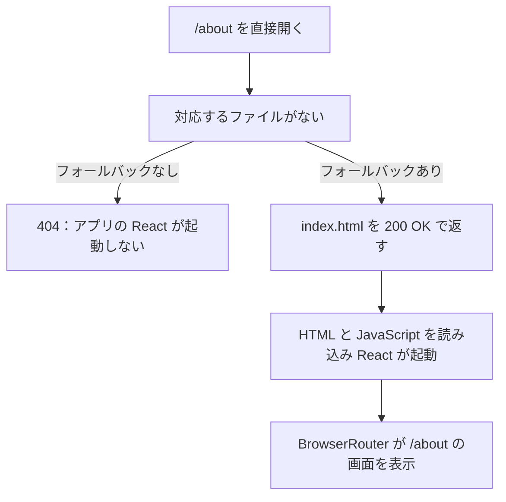

[:contents]

## はじめに

なんとなく Cloudflare も使ってみたくなり、GitHub Pages で公開していたアプリを移行した。

その際に `HashRouter` から `BrowserRouter` へ変更したことで、画面内の移動と直接アクセスで何が違うのか理解が深まった。公開先を変えるだけのつもりだったけど、思わぬ学びがあってよかった。

## GitHub Pages で BrowserRouter を使うと何が困るのか

例えば `BrowserRouter` で `/about` に紹介画面を割り当てると、React Router の `Link` からは移動できる。でも直接開いたり再読み込みしたりすると 404 になる。

画面内の移動は起動済みの React が処理するが、直接アクセスではサーバーへ HTML を取りに行く。

今回のように `index.html` から画面を切り替える SPA では、`/about` に対応する HTML ファイルはない。GitHub Pages には代わりに `index.html` を返す標準設定もないので、React が起動する前に 404 になる。

## だから HashRouter を使っていた

`HashRouter` では URL がこうなる。

```text
https://example.com/#/about
```

[ハッシュ部分はサーバーへ送られない](https://reactrouter.com/api/declarative-routers/HashRouter)ので、サーバーには `/` へのアクセスとして届く。

`index.html` と JavaScript を読み込んで React が起動し、React Router が `#/about` に合う画面を表示する。直接開いてもこの流れになるので 404 を避けられる。

## Cloudflare へ移行して BrowserRouter に変更した

Cloudflare Workers の[フォールバック設定](https://developers.cloudflare.com/workers/static-assets/routing/single-page-application/)を参考に、ファイルがない画面の URL に `index.html` を HTTP 200 で返す設定を `wrangler.jsonc` に追加した。

```json
"assets": {
  "not_found_handling": "single-page-application"
}
```

この設定を入れると、直接アクセスしたときの流れはこうなる。



URL は `/about` のまま。`/index.html` へリダイレクトせず、起動した React が URL を見て画面を選ぶ。

React 側も `HashRouter` から `BrowserRouter` に変更すると、先ほどの URL はこうなる。

```text
https://example.com/about
```

Cloudflare に限らず、このフォールバックを設定できる配信環境なら使えるな。

## おわりに

とりあえず移行してみただけだったけど、ルーティングへの理解が深まったり、URL もすっきりしたりした。

よかった。
